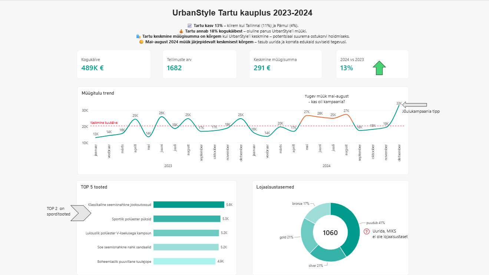

# DACA portfoolio – Laura Johanson

## Minust

Liigun andmeanalüütika valdkonda, tuues kaasa varasema töökogemuse statistika, aruandluse, andmete haldamise ja andmekvaliteedi valdkonnas.

DACA andmeanalüütika koolituse raames olen omandanud praktilisi oskusi SQL-i, Power BI ja Pythoni kasutamisel. Olen rakendanud neid oskusi nii individuaalsetes kui ka meeskonnaprojektides, analüüsides andmeid, koostades visualiseeringuid ja otsides andmetest äriliselt olulisi tähelepanekuid.

Mind huvitavad andmete analüüs, andmekvaliteet, aruandlus ja andmepõhiste otsuste toetamine.

## Oskused ja töövahendid

- **SQL:** päringud, andmete filtreerimine, puhastamine, JOIN-id ja agregeerimine
- **Power BI:** dashboard'id, aruanded, andmete visualiseerimine ja DAX
- **Python:** andmete töötlemine ja analüüs pandas'ega
- **Andmekvaliteet:** puuduvate väärtuste, duplikaatide ja ebakõlade tuvastamine
- **Excel:** andmete analüüs, liigendtabelid, graafikud ja aruandlus
- **Andmeallikad:** API-d ja Supabase
- **GitHub:** projektide dokumenteerimine ja versioonihaldus
- **Koostöö:** meeskonnatöö, tulemuste tutvustamine ja tehniliste muudatuste testimine

## Valitud projektid

### 1. UrbanStyle – Tartu kaupluse müügiandmete analüüs ja Power BI dashboard

Koostasin Tartu kaupluse interaktiivse dashboardi koos andmelooga, mis annab ülevaate müügitulemustest, kasvutrendist, TOP 5 tootest ja klientide lojaalsustasemetest.

Valisin peamised KPI-d ja visualiseeringud ning kujundasin dashboardi selge visuaalse hierarhiaga. Lisasin diagrammidele annotatsioonid ja keskmise käibe viitejoone. Dashboardi ülaossa koostasin juhtidele mõeldud kokkuvõtte nelja peamise järeldusega.

**Töövahendid:** Power BI, DAX

[Vaata 6. nädala projekti ja lisamaterjale](week-6/)

### 2. UrbanStyle – klientide RFM-segmenteerimine

Analüüsisin klientide ostukäitumist RFM-meetodi abil, kasutades ostude hiljutisust, sagedust ja rahalist väärtust. Segmenteerimise eesmärk oli eristada erineva ostukäitumisega kliendirühmi ja leida võimalusi turundustegevuste suunamiseks.

**Töövahendid:** Python, pandas, Plotly

[Vaata 7. nädala projekti](week-7/)

### 3. UrbanStyle – andmete pärimine ja töötlemine API kaudu

Töötasin Supabase'i kaudu saadud müügi-, kliendi- ja tooteandmetega. Koostasin Pythoni abil andmete pärimise ja töötlemise töövoo ning valmistasin andmed ette edasiseks analüüsiks.

**Töövahendid:** Python, pandas, Supabase, API

[Vaata 8. nädala projekti](week-8/)

## DACA koolituse nädalad

| Nädal | Teema | Materjalid |
|---|---|---|
| 0 | Sissejuhatus ja keskkonna seadistamine | [Vaata projekti](week-0/) |
| 1 | SQL-i alused | [Vaata projekti](week-1/) |
| 2 | Andmete puhastamine SQL-iga | [Vaata projekti](week-2/) |
| 3 | SQL JOIN-id | [Vaata projekti](week-3/) |
| 4 | SQL agregeerimine | [Vaata projekti](week-4/) |
| 5 | Andmete visualiseerimine | [Vaata projekti](week-5/) |
| 6 | Power BI dashboard ja andmelugu | [Vaata projekti](week-6/) |
| 7 | Python pandas – RFM-kliendisegmenteerimine | [Vaata projekti](week-7/) |
| 8 | Python – API-d ja andmete pärimine | [Vaata projekti](week-8/) |
| 9 | Karjääriks ettevalmistumine | [Vaata projekti](week-9/) |
| 10 | GitHubi portfoolio viimistlemine ja lõpukaitsmine | [Vaata projekti](week-10/) |

## Eesmärk

Soovin rakendada oma varasemat kogemust statistika, aruandluse ja andmekvaliteedi valdkonnas koos andmeanalüütika tehniliste oskustega, et muuta andmed arusaadavaks ja toetada nende põhjal tehtavaid otsuseid.

---

See portfoolio koondab DACA koolituse käigus valminud praktilised tööd ning näitab minu arengut andmeanalüütika valdkonnas.
